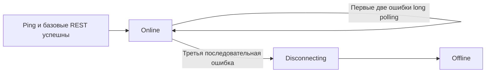
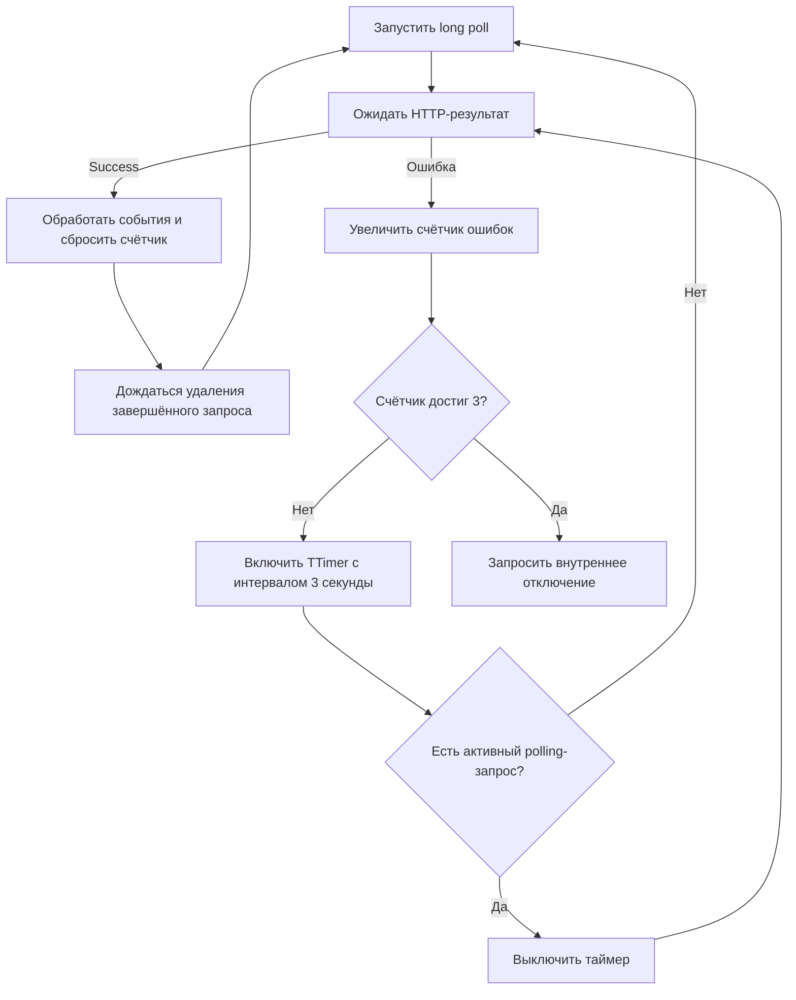

# Long polling по результатам HTTP

## Архитектурное решение

В [`syncthing_api.pas`](syncthing_api.pas) сделать callback `HTTP_EventAPI` единственным источником результата long polling. Глобальные `OnError`/`OnDisconnected` больше не должны менять FSM: `OnDisconnected` может следовать даже после успешного HTTP-ответа и сейчас создаёт ложные либо двойные переходы.

Состояние API-соединения:

Жизненный цикл long polling внутри `ssOnline`:

- После успешных ping и всех базовых REST-запросов сразу устанавливать `ssOnline`, вызывать `OnConnected` и запускать первый long poll.
- Переход в `ssOnline` не зависит от ответа long polling и поэтому не задерживается на срок до 60 секунд при отсутствии событий.
- Успешное завершение обычного long poll не переводит FSM в `ssOnline`: она уже находится в этом состоянии и продолжает в нём оставаться.
- **Success** — завершённый HTTP 200 с корректным JSON-массивом, включая пустой массив.
- Ошибкой считать неуспешный HTTP, транспортную ошибку или некорректный ответ.
- После успеха обработать события, сбросить число последовательных ошибок и запланировать следующий long poll, оставаясь в `ssOnline`.
- После первой и второй ошибки также оставаться в `ssOnline` и включать внедрённый в класс `TTimer` с интервалом 3 секунды.
- Таймер хранится в поле класса и управляется через `Enabled`. Каждые 3 секунды обработчик проверяет `FHTTPEvents.RequestInQueue('polling')`: при отсутствии запроса вызывает `StartLongPolling()` и оставляет таймер включённым; при наличии активного запроса устанавливает `Enabled := False`.
- Таймер также выключается после **Success**, при `Pause`, `Disconnect` и переходе в `ssOffline`.
- Наличие активного запроса предотвращает только дублирование. Оно не считается успехом и не сбрасывает счётчик ошибок.
- После третьей последовательной ошибки выполнить внутренний штатный переход `ssDisconnecting → ssOffline`, полностью очистив HTTP и таймеры.

## Изменения

- Удалить `FLongPollingWaitGoodBadCount`, 500-мс `FTimerLongPullingDoConnect`, `ssCmdLongPollingConnect` и проверку `RequestInQueue` как критерий online.
- Переиспользовать и переименовать неработающий `FTimerLongPollingErrorRestore` в `FTimerLongPollingRetry: TTimer`; задать `Interval := 3000`, исходное `Enabled := False` и описанный выше критерий отключения.
- Заменить эвристический `FLongPollingWaitGoodBadCount` на счётчик последовательных подтверждённых ошибок; увеличивать его только один раз в `HTTP_EventAPI`, сбрасывать только после успешного ответа.
- Упростить long-polling команды FSM до явных `failure`, `retry`, `force restart` и `failure limit`; убрать отдельные переходы по TCP `OnDisconnected`.
- Удалить `ssOnlineLongPollingWait`, `ssOnlineUnstable` и `ssOnlineUnstableLongPollingWait`: запуск, ожидание и первые две ошибки long polling не меняют состояние API-соединения.
- Считать `ssOnline` состоянием готовой API-сессии; `IsOnline` становится true сразу после базовой REST-загрузки. Активность event-запроса отслеживать отдельно и использовать только для управления long polling.
- В `HTTP_EventAPI` отдельно обрабатывать `HTTPErrorCode_ClientClosed` (`16499`) как ожидаемый результат `CancelAll()` или `AbortActiveConnection()`: не увеличивать счётчик ошибок и не запускать retry.
- Перед обработкой callback проверять, что текущее состояние FSM допускает long polling. Для защиты от дублирования сохранить `RequestInQueue('polling')`.
- Ввести внутреннюю причину отключения: превышение лимита ошибок должно использовать общую очистку состояния `ssDisconnecting`, но завершаться `OnHardDisconnect`, а не пользовательским `OnDisconnectedByUser`.
- Централизовать очистку в `ssDisconnecting`: выключить retry/watchdog, отменить REST и event HTTP, сбросить счётчик и перейти в `ssOffline`.
- Обновить `Syn_OnStateChanged` в [`umodulemain.pas`](umodulemain.pas), удалив ссылки на упразднённые wait-состояния; полную унификацию правил действий оставить отдельным следующим этапом.

В [`asynchttp.pas`](asynchttp.pas) исправить условие вызова `OnQueueEmpty` (`QueueCount = 0`). После успешного callback текущий именованный запрос ещё зарегистрирован до возврата из callback, поэтому следующий long poll запускать из `OnQueueEmpty`, когда предыдущий запрос уже удалён. После ошибки немедленный запуск не выполнять: им управляет только 3-секундный таймер.

## Защита от зависшего long polling

`FHTTPEvents.IOTimeout` передаётся в сокет и обычно завершает зависшее чтение, но абсолютной гарантии для FPC, сокетного слоя Windows и нестандартных сетевых состояний нет. Поэтому `FTimerLongPollingForceRestart` сохранить как независимый watchdog.

- Установить интервал watchdog больше штатных 60 секунд long polling и локального `IOTimeout`, например 65 секунд.
- Включать или перезапускать watchdog при запуске каждого long-poll запроса; выключать после callback, при `Pause`, `Disconnect` и переходе в `ssOffline`.

- При срабатывании watchdog его обработчик увеличивает счётчик на один до вызова `CancelAll()`, который выполняет `Terminate()` и принудительно закрывает сокет через `DisconnectFromServer()`.
- Последующий вызов `TSyncthingAPI.HTTP_EventAPI` со статусом `HTTPErrorCode_ClientClosed` (`16499`) полностью игнорировать: он никогда не изменяет счётчик и не запускает retry.

- После watchdog-ошибки применять общую политику: при счётчике меньше 3 включить 3-секундный retry-таймер, при значении 3 выполнить `ssDisconnecting → ssOffline`.

